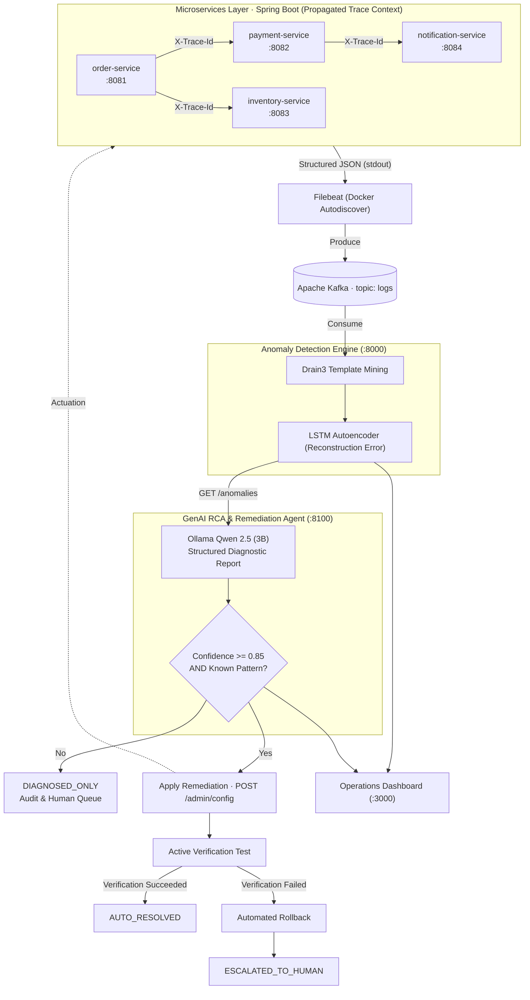
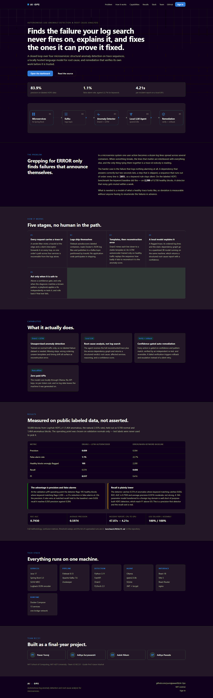
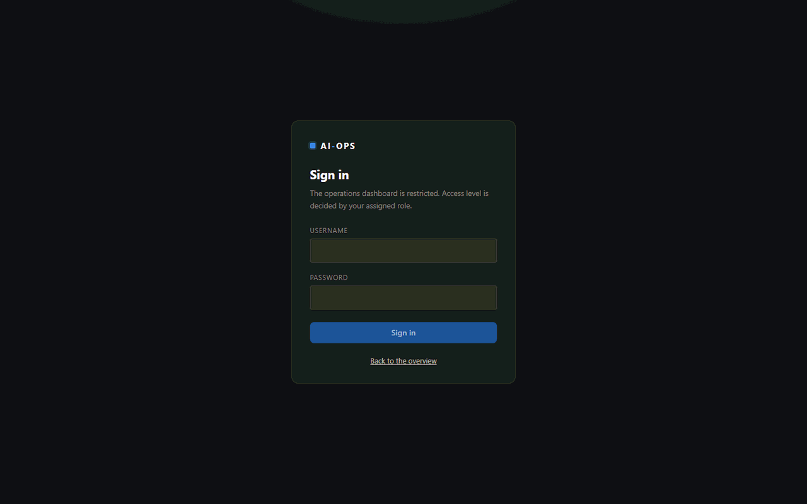
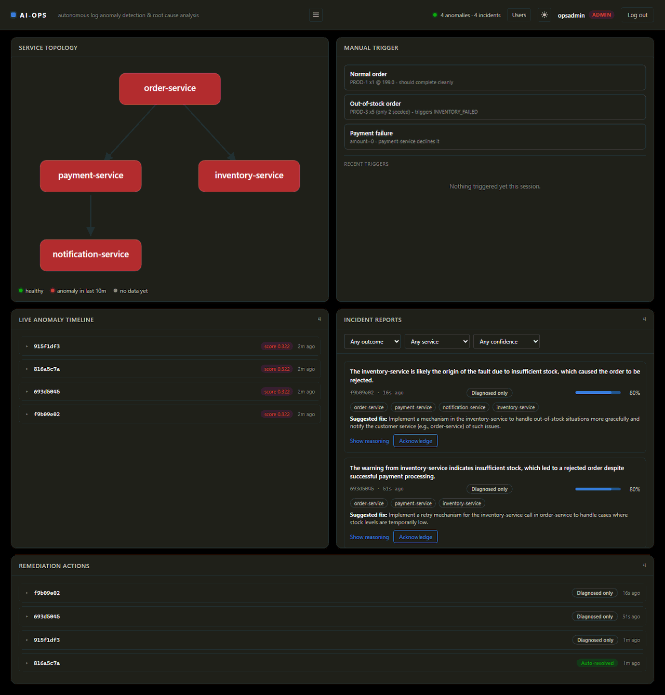

# TraceMind: Autonomous Log Anomaly Detection & Self-Healing AIOps Platform

[](#architecture)
[](#core-components)
[](#root-cause-analysis)
[](#streaming-pipeline)
[](#tech-stack)
[](#live-operations-dashboard)

**TraceMind** is an enterprise-grade, fully self-hosted AIOps platform that unifies **Distributed Tracing**, **Deep Learning (LSTM Autoencoder)**, and **Local Generative AI (LLM)** into an autonomous closed-loop operations pipeline. 

It continuously monitors multi-service transactional paths, detects subtle logic-level anomalies without keyword dependence, performs contextual root cause analysis (RCA), and safely executes automated remediation with independent verification and instant rollback.

---

## Author & Project Lead

Developed and maintained by **Yash Rai**.  
GitHub Repository: [https://github.com/yashxcode91/TraceMind](https://github.com/yashxcode91/TraceMind)

---

## Problem Statement & Motivation

In distributed microservice architectures, transactions traverse isolated network boundaries, generating high-volume, disparate log streams. When system anomalies occur:
1. **Disconnected Telemetry:** Log lines lack shared transaction context, forcing engineers to manually correlate disparate timestamps across multiple services.
2. **Invisible Logic-Level Failures:** Critical failures often occur without runtime exceptions or stack traces (e.g., silent order declines, skipped downstream reservations, latent processing degradation). Traditional grep/regex rules keyed on `ERROR` alerts fail to identify these silent degradations.
3. **Alert Fatigue & Operational Delay:** Keyword matching yields high false-positive rates on normal transient warnings while missing actual sequence order inversions.

**TraceMind** bridges this gap by offering an autonomous loop: **Distributed Correlation → Unsupervised Detection → GenAI Diagnosis → Closed-Loop Auto-Remediation**.

---

## System Architecture



### Architectural Highlights

1. **Deterministic Edge Tracing:** Gateway generates a unique `traceId` injected into the SLF4J MDC, propagated across downstream calls via servlet filters and HTTP client interceptors.
2. **Zero-Code Instrumentation Ingestion:** Microservices emit structured JSON logs to `stdout`. Filebeat leverages Docker autodiscovery to harvest, parse, and partition logs into Apache Kafka keyed by `traceId`.
3. **Unsupervised Neural Anomaly Scoring:** Drain3 extracts structured log templates. An LSTM Autoencoder scores sequences based on reconstruction error against learned normal operational distributions.
4. **Local Generative AI Root Cause Analysis:** A local quantized LLM (`qwen2.5:3b`) receives the parsed sequence, topology graph, and error metrics, outputting deterministic JSON containing the root cause, affected services, and recommended remediations.
5. **Fail-Safe Closed-Loop Remediation:** High-confidence playbooks actuate runtime configuration changes, trigger verification checks, and automatically roll back if post-fix validations fail.

---

## User Interface & Operational Console

The platform provides a reactive, single-page operations console built with React 18 and Vite, reverse-proxied via Nginx.

### Landing Overview & Pipeline Showcase

*Public overview showing architecture walkthrough, benchmark comparisons, and system capabilities.*

### Secure Authentication & Role-Based Access Control

*Role-Based Access Control (ADMIN, ENGINEER, VIEWER) enforced by backend JWT cookies.*

### Operations Management Dashboard

*Interactive topology visualization, real-time anomaly timeline, GenAI incident report cards, and autonomous remediation audit trail.*

---

## Technology Stack

| Layer | Component | Technical Specification |
|---|---|---|
| **Microservices** | Java 17 / Spring Boot | Spring Boot 3.3.2, SLF4J MDC, Logstash Logback Encoder |
| **Distributed Tracing** | Hand-rolled Trace Context | Servlet Filters + `RestTemplate` Interceptors (HTTP header `X-Trace-Id`) |
| **Log Streaming** | Filebeat & Apache Kafka | Filebeat 8.13.4 (JSON driver), Confluent Kafka 7.6.1 + Zookeeper |
| **Template Parsing** | Drain3 Engine | Online template extraction, fixed-depth parse trees |
| **Anomaly Detection** | PyTorch Deep Learning | Bidirectional/Stacked LSTM Autoencoder (16.2K params, CPU-optimized) |
| **Root Cause Analysis** | Generative AI | Ollama runtime, `qwen2.5:3b` quantized weights, JSON Schema validation |
| **Remediation Agent** | Python / FastAPI | FastAPI 0.111, SQLite audit store, dynamic HTTP playbooks |
| **Frontend UI** | React 18 / Vite | Single-page application, custom CSS design system, Nginx reverse proxy |
| **Container Runtime** | Docker Compose | 13 multi-container services, unified internal bridge network |

---

## Empirical Evaluation & Benchmarks

The system was evaluated against both synthetic multi-service fault scenarios and the industry-standard **LogHub HDFS** benchmark dataset. Comprehensive results and curves are documented in [`benchmark/RESULTS.md`](benchmark/RESULTS.md).

### 1. Public Benchmark: LogHub HDFS_v1
- **Dataset Size:** 50,000 blocks (1,464 anomalous; 2.93% natural fault incidence).
- **Hold-out Evaluation:** 9,708 normal sequences, 1,464 anomalous sequences.
- **ROC-AUC:** **0.7930** | **Average Precision:** **0.5974**

| Metric | LSTM Autoencoder (Validation p99) | Standard Keyword Baseline (`ERROR`/`WARN`) | Improvement |
|---|---|---|---|
| **Precision** | **0.839** | 0.304 | **+176%** |
| **Recall** | 0.374 | **0.656** | — |
| **F1-Score** | **0.517** | 0.416 | **+24.3%** |
| **False-Positive Rate** | **1.1%** (105 false alarms) | 22.7% (2,200 false alarms) | **21× Reduction in False Alarms** |

> **Key Finding:** In enterprise log monitoring, high false-positive rates cause alert fatigue. TraceMind delivers a **21× reduction in false alarms** compared to standard regex/keyword approaches while preserving high operational precision.

### 2. End-to-End Microservice Fault Injection (TraceMind Stack)
Evaluation across 400 labeled transactions (300 healthy baselines + 4 distinct fault categories × 25 repetitions):

| Fault Classification | TraceMind LSTM (Default v1) | Experimental (v2) | Keyword Baseline |
|---|---|---|---|
| `amount_zero` (Payload validation failure) | **1.000** | 1.000 | 1.000 |
| `notification_down` (Downstream outage) | **1.000** | 1.000 | 1.000 |
| `out_of_stock` (Business logic failure) | **1.000** | 1.000 | 1.000 |
| `inventory_latency` (Silent performance drift) | 0.200 | **1.000** | **0.000 (Complete Miss)** |
| **Overall F1-Score** | **0.8421** | **0.9479** | **0.8571** |
| **Overall False-Positive Rate** | **3.3%** | 3.7% | **0.0%** |

---

## Quick Start & Deployment Guide

### System Prerequisites
- **Docker Engine:** Version 24+ and Docker Compose v2.
- **Memory Allocation:** Minimum **10 GB RAM** assigned to Docker runtime (crucial for Kafka, microservice JVMs, and local LLM execution).
- **Disk Space:** Minimum 5 GB free disk.

#### Configuring Docker Memory (Windows WSL2)
Create or update `%USERPROFILE%\.wslconfig`:
```ini
[wsl2]
memory=10GB
swap=4GB
```
Apply via PowerShell: `wsl --shutdown` and restart Docker Desktop. *(On macOS, adjust via Settings → Resources → Memory).*

---

### Step 1: Clone Repository & Configure Environment

```bash
git clone https://github.com/yashxcode91/TraceMind.git
cd TraceMind
cp .env.example .env
```

Generate secure credentials for `.env`:
```bash
# Generate secrets
JWT_SECRET=$(openssl rand -hex 32)
SERVICE_API_KEY=$(openssl rand -hex 24)
```

Configure `.env` variables:
```dotenv
JWT_SECRET=<generated_32_byte_secret>
SERVICE_API_KEY=<generated_24_byte_secret>
ADMIN_USERNAME=admin
ADMIN_PASSWORD=your_secure_password
JWT_TTL_MINUTES=60
SESSION_COOKIE_SECURE=false
```

---

### Step 2: Launch Platform Services

#### Standard CPU Mode (Default)
```bash
docker compose up -d --build
```

#### NVIDIA GPU Accelerated Mode
If an NVIDIA GPU with the Container Toolkit is present, offload LLM inference to accelerate diagnosis (~47s CPU down to ~4s GPU):
```bash
docker compose -f docker-compose.yml -f docker-compose.gpu.yml up -d --build
```

On initial startup, an init container automatically pulls the quantized `qwen2.5:3b` model into persistent storage.

---

### Step 3: Access Platform Endpoints

Verify container status:
```bash
docker compose ps
```

| Service | Access URL | Authentication / Protocol |
|---|---|---|
| **Web Console** | `http://localhost:3000` | Public landing page; `/app` requires login |
| **Order Gateway API** | `POST http://localhost:8081/orders` | Public application gateway |
| **Anomaly Detection API** | `http://localhost:8000/anomalies` | `X-Service-Key` or Session Cookie |
| **RCA Agent API** | `http://localhost:8100/incidents` | `X-Service-Key` or Session Cookie |
| **Order Runtime Admin** | `http://localhost:8081/admin/config` | `X-Service-Key` Header |
| **Inventory Admin** | `http://localhost:8083/admin/inventory` | `X-Service-Key` Header |

---

## Live Demonstration Walkthrough

Log in to the console (`http://localhost:3000/login`) using the credentials defined in your `.env`. Navigate to the **Manual Trigger Panel** to execute realistic failure scenarios:

1. **Baseline Transaction (`Normal Order`):**
   * Dispatches a normal transaction for `PROD-1` ($199.00).
   * Verified across all 4 services under a common `traceId`. No anomaly is triggered.
2. **Logic Fault (`Out-of-Stock Order`):**
   * Attempts to reserve quantity 5 of `PROD-3` when stock is capped at 2.
   * Demonstrates an inconsistent partial failure: payment succeeds, but inventory reservation fails. Flagged at ~0.32 reconstruction error; RCA identifies `inventory-service` with >90% confidence.
3. **Closed-Loop Self-Healing (`Payment Zero Failure`):**
   * Injects an order with amount `0.0`.
   * The anomalous trace is flagged. The GenAI RCA identifies the invalid parameter payload and triggers remediation playbook `reject_invalid_amount`.
   * **Verification & Healing:** The agent invokes `POST /admin/config` on `order-service`, installs input validation at the gateway, and tests a follow-up invalid transaction. Once confirmed (`REJECTED_AT_GATEWAY`), incident state shifts to `AUTO_RESOLVED`.

---

## Repository Structure

```
TraceMind/
├── services/                     # Microservice Implementations (Java 17, Spring Boot 3.3)
│   ├── order-service/            # Gateway entry point, validation filter & runtime actuation
│   ├── payment-service/          # Transaction processing & downstream notification trigger
│   ├── inventory-service/        # Stock management & reservation logic
│   └── notification-service/     # Asynchronous leaf notification mock
├── log-pipeline/                 # Log Harvesting & Stream Ingestion (Filebeat -> Kafka)
├── anomaly-detector/             # Unsupervised Anomaly Engine (FastAPI, Drain3, PyTorch)
│   ├── app/                      # Feature extractor, LSTM model definition, scoring engine
│   ├── training/                 # Offline training pipeline for baseline sequence learning
│   └── models/                   # Pretrained models, Drain3 state, and threshold metadata
├── rca-agent/                    # GenAI Diagnostic & Remediation Engine (FastAPI, Ollama)
│   └── app/                      # Dependency topology, LLM client, self-healing playbooks
├── dashboard/                    # React 18 Operations Console (Vite, Nginx reverse proxy)
│   ├── src/components/           # Topology graph, timeline, remediation audit panels
│   └── src/pages/                # Landing page, auth routes, operational dashboard
├── benchmark/                    # Reproducibility Suite (HDFS evaluation & fault injection)
│   ├── results/                  # Serialized metrics, ROC curves, timing evaluations
│   └── RESULTS.md                # Full benchmarking methodology and evaluation logs
├── docker-compose.yml            # Primary multi-container definition (13 services)
├── docker-compose.gpu.yml        # NVIDIA container toolkit GPU override configuration
└── .env.example                  # Environment configuration template
```

---

## Engineering Design Decisions

- **Deterministic Distributed Tracing:** Rather than introducing heavy dependencies like OpenTelemetry agents, tracing utilizes lightweight SLF4J MDC injection and custom servlet filters, guaranteeing deterministic behavior across container hops.
- **Unsupervised Anomaly Formulation:** Real-world systems rarely provide labeled anomaly corpora. Training the LSTM autoencoder strictly on healthy traffic ensures any structural disruption (omitted calls, misordered handoffs, anomalous latency) natively triggers reconstruction degradation.
- **Defensive LLM Autonomy:** LLMs are prone to hallucinations. TraceMind enforces strict guardrails: actions require `>= 0.85` model confidence, must match pre-approved deterministic playbooks, execute independent verification checks, and retain automated rollback capability.

---

## License & Attribution

Developed and maintained by **Yash Rai**.  
For inquiries, contributions, or discussions, please visit [https://github.com/yashxcode91/TraceMind](https://github.com/yashxcode91/TraceMind).
